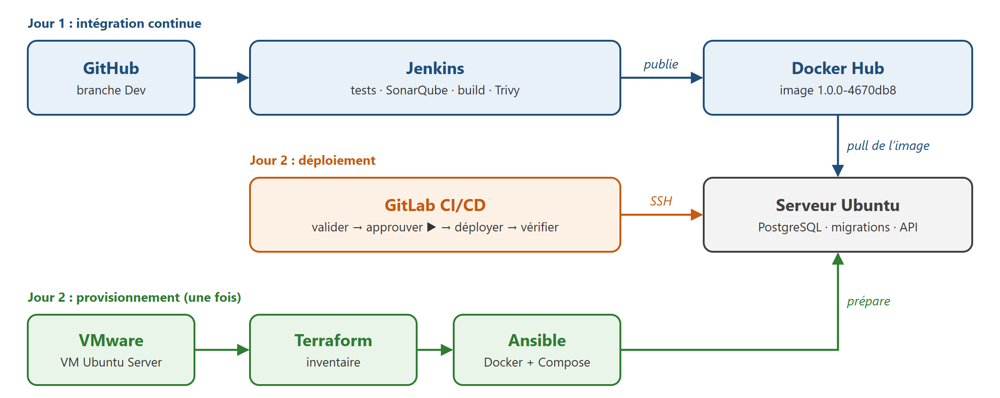
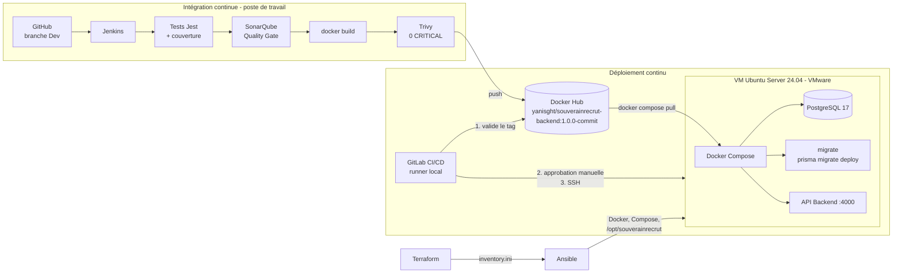

# Architecture - Chaîne CI/CD SouverainRecrut Backend

## Vue d'ensemble

La chaîne est découpée en deux parties indépendantes, reliées par **une image Docker versionnée sur Docker Hub** :

- **Intégration continue (Jenkins)** : le code de la branche `Dev` est testé, analysé, conteneurisé, scanné, puis publié sur Docker Hub.
- **Déploiement continu (GitLab CI/CD)** : une image déjà publiée est récupérée et déployée sur le serveur Ubuntu, sans jamais être reconstruite.



Vue détaillée :



## Composants

| Composant | Version | Emplacement | Rôle |
|---|---|---|---|
| GitHub | - | `github.com/YGachot/souverainrecrut`, branche `Dev` | dépôt du code et des livrables (fork du dépôt de référence) |
| Jenkins | LTS, JDK 21 | conteneur sur le poste (port 8080) | orchestre l'intégration continue (`Jenkinsfile`) |
| SonarQube | Community Build 26.11 | conteneur sur le poste (port 9000) | analyse statique, couverture, Quality Gate |
| Trivy | 0.76.2 | conteneur éphémère lancé par Jenkins | analyse des vulnérabilités de l'image |
| Docker Hub | - | `yanisght/souverainrecrut-backend` | registre des images versionnées |
| VMware Workstation Pro | 17.6.4 | poste de travail | héberge le serveur de déploiement |
| Ubuntu Server | 24.04.5 LTS | VM : 2 vCPU, 4 Go RAM, réseau NAT, `192.168.42.129` | serveur de production |
| Terraform | 1.17.0, provider `hashicorp/local` 2.9.1 | poste de travail | décrit le serveur et génère l'inventaire Ansible |
| Ansible | ansible-core 2.16.3 | WSL Ubuntu 24.04 sur le poste | prépare le serveur |
| GitLab CI/CD | gitlab.com, runner 19.5.3 | projet `souverainrecrut-deploiement`, runner en conteneur sur le poste | pipeline de déploiement |
| Docker Engine / Compose | 29.1.3 / 2.40.3 | VM | exécute les services |
| PostgreSQL | 17.11 (Alpine 3.24) | conteneur sur la VM | base de données |
| API Backend | Node 22.23.4, Express 5, Prisma 6.16.2 | conteneur sur la VM (port 4000) | application déployée |

## Intégration continue

Le `Jenkinsfile`, à la racine du dépôt, enchaîne 8 étapes. Chacune doit réussir pour que la suivante s'exécute :

```
Checkout Dev → npm ci → prisma generate → tests + couverture → SonarQube + Quality Gate
            → docker build → Trivy (0 CRITICAL) → docker push
```

- **Tag de l'image** : `<version de package.json>-<commit court>`, par exemple `1.0.0-4670db8`. Toute image renvoie à un commit précis.
- **Contrôles bloquants** : tests, Quality Gate SonarQube (attendu par le scanner) et Trivy (`--exit-code 1`). Une image qui ne passe pas les contrôles n'est jamais publiée.
- **Image Backend** : build multi-stage (`backend/Dockerfile`). L'étape de build compile TypeScript et génère le client Prisma ; l'image finale ne reçoit que `package.json`, les dépendances de production, `dist/`, le client Prisma généré et le dossier `prisma/` (schéma et migrations). Le `.dockerignore` exclut `.env*`, les tests, la couverture et les fichiers de configuration des outils.

## Provisionnement

| Étape | Outil | Résultat |
|---|---|---|
| Création de la VM | manuelle (VMware Workstation) | Ubuntu Server installé, SSH activé, snapshot de référence |
| Description du serveur | Terraform | `deploiement/ansible/inventory.ini` (hôte, utilisateur, clé, répertoire) |
| Préparation | Ansible | système à jour, Docker Engine et plugin Compose installés et actifs, `/opt/souverainrecrut` créé, utilisateur `yanis` autorisé à utiliser Docker |

Le provider Terraform vSphere exige ESXi ou vCenter, absents ici. Terraform agit donc sur la ressource réellement disponible : l'inventaire qui fait le lien avec Ansible.

## Déploiement

### Pipeline GitLab

```
valider-tag ──► [approbation manuelle] ──► deployer-production ──► verifier-deploiement
```

| Job | Exécution | Actions |
|---|---|---|
| `valider-tag` | automatique | variables présentes, format `x.y.z-commit`, tag présent sur Docker Hub |
| `deployer-production` | **manuelle** (`when: manual`, bloquante) | SSH : copie de `docker-compose.yml`, écriture du `.env`, `docker login` / `pull` / `logout`, `docker compose up -d` |
| `verifier-deploiement` | automatique après le déploiement | état `healthy`, image en cours = image demandée, `/v1/health` et `/v1/ready` |

Le serveur est sur le réseau NAT de VMware : il n'est pas joignable depuis les runners partagés de gitlab.com. Le runner est donc installé sur le poste de travail, qui voit la VM. Il ne prend que les jobs portant le tag `souverainrecrut`.

### Services sur le serveur

```
/opt/souverainrecrut/
├── docker-compose.yml     transmis par le pipeline
└── .env                   écrit par le pipeline à partir des variables GitLab (droits 600)

réseau "backend"
  db       postgres:17.11-alpine3.24   volume postgres-data   healthcheck pg_isready
  migrate  image Backend               prisma migrate deploy, une seule fois, puis arrêt
  backend  image Backend               port 4000              healthcheck /v1/ready
```

Ordre de démarrage garanti par `depends_on` : `db` (healthy) → `migrate` (terminé avec succès) → `backend`. Si une migration échoue, l'API ne démarre pas. `db` et `backend` redémarrent automatiquement (`unless-stopped`).

## Flux réseau

| Source | Destination | Port | Usage |
|---|---|---|---|
| Jenkins | GitHub | 443 | checkout |
| Jenkins | SonarQube (`host.docker.internal`) | 9000 | analyse et Quality Gate |
| Jenkins | Docker Hub | 443 | publication de l'image |
| Runner GitLab | gitlab.com | 443 | récupération des jobs |
| Runner GitLab | Docker Hub (API) | 443 | validation du tag |
| Runner GitLab | VM | 22 | déploiement SSH |
| Runner GitLab | VM | 4000 | vérification de l'API |
| VM | Docker Hub | 443 | `docker compose pull` |
| `backend`, `migrate` | `db` | 5432 | réseau Docker interne uniquement, non exposé |

## Gestion des secrets

| Secret | Stockage | Utilisation |
|---|---|---|
| Token SonarQube | credential Jenkins `sonarqube-token` | `withSonarQubeEnv`, masqué dans les logs |
| Identifiants Docker Hub (écriture) | credential Jenkins `dockerhub` | `withCredentials`, `--password-stdin` |
| Token Docker Hub (lecture seule) | variable GitLab masquée, cachée, protégée | transmis par l'entrée standard de SSH |
| Clé privée de déploiement | WSL (`~/.ssh`) + variable GitLab masquée (base64) | n'existe que dans le conteneur du job |
| `POSTGRES_PASSWORD`, `JWT_SECRET` | variables GitLab masquées, cachées, protégées | écrits uniquement dans le `.env` du serveur |

Aucun secret n'est versionné. Les `.gitignore` excluent `.env`, `*.tfstate`, `*.tfvars` et `.terraform/`.

Deux tokens Docker Hub distincts sont utilisés : Jenkins publie (lecture/écriture), le serveur ne fait que télécharger (lecture seule).

## Traçabilité

```
commit 4670db8 (GitHub, Dev)
  └─ build Jenkins #2 : tests, SonarQube, Trivy
       └─ image yanisght/souverainrecrut-backend:1.0.0-4670db8 (Docker Hub)
            └─ pipeline GitLab #3049258782 (approuvé manuellement)
                 └─ conteneur backend sur 192.168.42.129, vérifié par le pipeline
```
